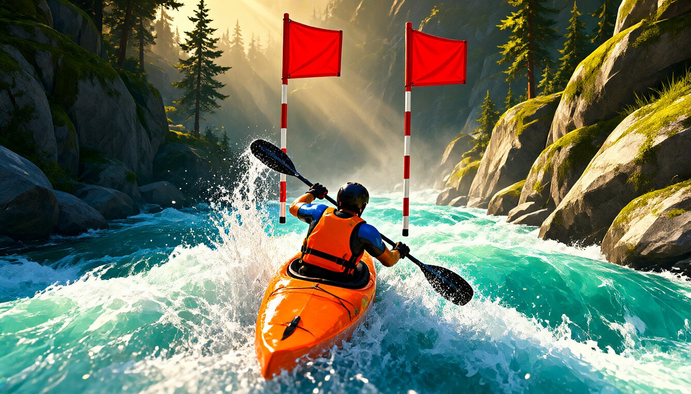

# KAYAK RIVER RUSH

> 急流に乗って下れ。川はカーブするたびに船を外側へ押す。カヤックのノリで流れに逆らえ。

ブラウザで遊べる 3D ホワイトウォーター・カヤックゲームです。
長さ 1,500m の川を 34 個のゲートくぐりながら、下りきった先の桟橋まで進みます。



---

## 目次

- [ローカルで遊ぶ](#ローカルで遊ぶ)
- [ゲームの概要](#ゲームの概要)
- [操作方法](#操作方法)
- [視点切り替え](#視点切り替え)
- [スコアの仕組み](#スコアの仕組み)
- [難易度](#難易度)
- [技術スタック](#技術スタック)
- [リポジトリ構成](#リポジトリ構成)
- [LICENSE / クレジット](#license--クレジット)

---

## ローカルで遊ぶ

### 方法 1：バッチファイル（Windows）

`start-game.cmd` を**ダブルクリック**するだけ。

```
http://localhost:8123/kayak3d/index.html
```

ローカルサーバーが自動で立ち上がり、ブラウザが開きます。
止めるときは、画面を最小化してる `kayak3d-server` ウィンドウを閉じてください。

> `index.html` は直接開いても動きますが、ブラウザの CORS 制約を避けるため
> サーバーを経由する方が安全です。

### 方法 2：任意の static サーバー

```bash
# Python
python -m http.server 8123

# Node.js
npx serve .
```

その後 `http://localhost:8123/index.html` を開いてください。

### GitHub Pages で公開する

1. このフォルダ（`kayak3d/`）の中身だけをリポジトリのルートに置く
   （`index.html` がルート直下、`assets/` と `trees.module.js` はその隣）
2. リポジトリで **Settings → Pages → Source: Deploy from a branch**
3. ブランチと `/ (root)` を選択

**ビルド不要**です。`three.js` は CDN から importmap で読み込むため、
そのままコミットするだけで動きます。`start-game.cmd` は Pages では不要です。

| ファイル | サイズ | 役割 |
|---|---:|---|
| `index.html` | 95 KB / 2,054 行 | ゲーム本体（HTML + CSS + JS すべて入り） |
| `trees.module.js` | 59 KB / 920 行 | 手続き生成ローポリ樹木ライブラリ |
| `assets/` | — | 画像 7 枚（下記） |
| `start-game.cmd` | 0.7 KB | Windows 用ランチャー（Pages では不要） |

---

## ゲームの概要

```
スタート ──► 34 個のゲートをくぐる ──► ゴール（桟橋）
             ▲                         ▲
        ▲ 旗 2 本の間を通ると得点      岩に触ると弾かれて減点
        ▼ 連続して通ると combo 倍率
```

- **川** は一定勾配（全体で 30m 落ちる）で、蛇行しながら幅も変化する
- **流れは横方向にも船を押す**。カーブの外側ほど強い
- **旗ゲート**（赤旗 2 本の間）を通ると得点。中心を通れば PERFECT
- **岩**にぶつかると弾かれて減点。画面も揺れる
- **2 か所に段差（滝）**。手前にせり上がりがあり、船は浮いてから落ちる
- 最後に**ゴールの桟橋**。全ゲート通ると `PERFECT RUN!`

ゲームオーバーすると**まったく同じコース**が再生されます（固定 seed）。
つまり「コースを覚える」ことができ、リトライでのスコア向上が可能です。

---

## 操作方法

**タイトル画面の上部に「CONTROLS — 操作方法」として表示しています。**
初めての方は「A / D で漕ぐ」ことがわかれば遊べます。

| キー | 動作 |
|---|---|
| `A` / `←` | 左へ漕ぐ（押し流される方向に対して） |
| `D` / `→` | 右へ漕ぐ |
| `W` / `↑` | 前進漕ぎ（加速） |
| `R` | リスタート |
| `C` | 視点の切り替え |
| `M` | ミュート |
| `Space` | スタート / もう一度 |

**タッチ操作**にも対応しています（画面下部の ◀ ▶ 漕ぐ）。

ゴールした画面には「もう一度（SPACE）」に加えて
**「タイトル画面に戻る」** ボタンがあります。
難易度やアバターを変えたいときはそこから戻ってください。

### アバター（VRM）について

`index.html` の `VRM_BUNDLED` で「VRM を同梱するか」を切り替えます。
| `VRM_BUNDLED` | 用途 | 挙動 |
|---|---|---|
| `false`（既定） | **公開版（GitHub Pages）** | AVATAR のドロップダウンは「アバターなし（既定）」だけ。`V` キーは何も起きません |
| `true` | 自分の PC で遊ぶとき | `assets/Model/` の VRM を一覧に出し、`V` キーで切り替えられます |

VRM はライセンス（Proprietary）のためリポジトリには含めません。
公開版の訪問者は、タイトル画面の **「ファイル…」** から
自分の PC にある VRM を選んで読み込めます（ブラウザ内のみ。サーバーに保存はされません）。

公開版でアバターを使わせたい場合は、`VRM_LIST` を任意の URL を持たせる形に変更が必要です。

### 言語（日本語 / English）

タイトル画面の右上に **「日本語 / EN」** の切り替えボタンがあります。
選んだ言語は `localStorage` に保存され、次回開いてもその言語で始まります。

| | 日本語 | English |
|---|---|---|
| タイトル画面 | ○ | ○ |
| リザルト画面 | ○ | ○ |
| 画面下部の操作ヒント | ○ | ○ |
| プレイ中のポップアップ | ○ | ○（MISS / SHORE! など） |
| HUD のラベル（SCORE / TIME / GATE など） | もともと英語 | そのまま |

※ 公開版（`VRM_BUNDLED = false`）でも切り替えは使えます。

---

## 視点切り替え

`C` キーを押すたびに巡回します。

| 順 | 視点 | 高さ / 距離 | 画角 | 向いている方向 |
|:--:|---|---|:--:|---|
| 1 | **3人称（チェイス）** | 1.8m / 後ろ 6.2m | 61° | 真後ろ。スピード感と川の全体像 |
| 2 | **一人称（POV）** | 1.3m（目の位置） | 82° | 船首・櫂・腕が見える。後頭部も少し見える。段差や岩の回避 |
| 3 | **正面** | 船の前方 2.6m / 水面上 0.34m | 88° | 水面すれすれから小さく見上げる広角。GoPro 風 |

- 正面は GoPro 風。水面すれすれ（水面上 34cm）から小さく見上げる広角（88°）。
  船の前方 2.6m に置き、船首が画面下に入る。アバターは近くに大きく見え、顔も見える。
  ただし下流のゲートは画面に入らないので、フィルム観として使う。追従遅延をさせず、カメラを船に固定している（`camK = 0`）。

---

## スコアの仕組み

| イベント | 点数 |
|---|:---:|
| ゲート通過 | **+120** |
| ゲート中央（PERFECT） | **+240** |
| 岩に当たった | **−120** |

- 連続してゲートを通すと **combo 倍率**（最大 ×10）が付きます
- ゴール時のランク

| ランク | スコア |
|:--:|---:|
| **S** | 6,000 以上 |
| **A** | 4,400 以上 |
| **B** | 3,000 以上 |
| **C** | それ未満 |

---

## 難易度

| | EASY | NORMAL | HARD |
|---|:---:|:---:|:---:|
| カーブで押される強さ | 0.055 | 0.115 | **0.200** |
| 乱流の強さ | 0.16 | 0.40 | **0.62** |
| ゲートの幅 | ×1.28 | ×1.00 | **×0.70** |
| ゲートの判定幅 | ×1.22 | ×1.00 | ×0.86 |
| 岩の密度 | −60 | −120 | **−180** |
| 岩の当たり半径 | 0.68 | 0.82 | **0.92** |

HARD ではゲートの旗が物理的に狭くなり、当たり判定も大きくなります。

---

## 技術スタック

- **[three.js](https://threejs.org/) 0.160.0** — importmap 経由で jsDelivr CDN から読み込み
- **ビルドツールなし**。素の HTML + ES Modules
- **WebAudio API** — 川音・漕ぐ音・飛沫音はすべて**合成音**（音声ファイルは 0 個）
- **カスタム GLSL** — 水面シェーダ（流れ・白波・段差・岩の回り泡）
- **手続き生成** — 樹木はすべてコード生成（画像ファイルなし）
- コースは **mulberry32** の固定 seed で決定

---

## リポジトリ構成

```
kayak-river-rush/
├─ index.html          # ゲーム本体（すべて入り）
├─ trees.module.js     # 手続き生成ローポリ樹木
├─ assets/
│  ├─ title_hero.jpg   # タイトル背景
│  ├─ banner.png       # FINISH 看板
│  ├─ banner_start.png # START 看板
│  ├─ water_foam.jpg   # 水面の白波テクスチャ / 滝のカーテン
│  ├─ ground_detail.jpg# 岸のディテール
│  ├─ foam.png         # パーティクル（泡）
│  └─ splash.png       # パーティクル（飛沫）
├─ docs/
│  ├─ DESIGN.md        # ゲームデザイン仕様
│  ├─ TECH.md          # 設計・実装メモ
│  └─ ASSETS.md        # アセットの作り方
└─ README.md
```

---

## 開発

よく触る定数はすべて `index.html` 冒頭（`CFG` / `DIFFS` / `DROPS`）にまとまっています。

```js
const CFG = {
  LENGTH: 1500,       // 川を下る距離(m)
  totalDrop: 30,      // 累積落差(m)
  halfW: 10.5,        // 川幅の半分
  speedBase: 11.5,    // 基本流速 m/s
  strokeLat: 5.6,     // 1 櫂あたりの横推進
  strokeRate: 1.35,   // 1 秒あたりの櫂サイクル数
  PTS: { gate: 120, perfect: 240, rock: -120 },
};

const DROPS = [
  { z: -455,  h: 2.0, w: 5.0, swell: 0.60, swellLen: 9  },
  { z: -1010, h: 2.5, w: 5.5, swell: 0.72, swellLen: 10 },
];
```

段差の `h`（落差）と `w`（落ちる距離）を変えるだけで、滝の大小が調整できます。
`w` を小さくすると「ゆっくり坂」ではなく「落ちる」形になります。

---

## LICENSE / クレジット

### ライセンス

本リポジトリのコード（`index.html` / `trees.module.js` / `start-game.cmd`）は
自由に使って頂いて構いません。

### AI 生成物について

このプロジェクトの素材・コードには **AI をアシスタントとして**使っています。

| 用途 | 使用したモデル / ツール |
|---|---|
| 画像素材（7 枚） | **Qwen-Image-2.1**（Unsloth Desktop / `unsloth/Qwen-Image-2.1-GGUF`、ローカル実行） |
| 樹木 | コードによる手続き生成（画像モデル不使用） |
| コード | **opencode** との対話で執筆。使用した LLM は **MiniMax M3.1 Flash Free** と **Space Bunny Free**（ステルスモデル） |

生成画像の作り方は [`docs/ASSETS.md`](docs/ASSETS.md) に書きました。
再利用・商用利用の際は、各モデル・画像のライセンスを確認してください。

### クレジット

- [three.js](https://threejs.org/) — MIT License
- 画像生成: [Qwen-Image-2.1](https://huggingface.co/unsloth/Qwen-Image-2.1-GGUF)
- コード生成: MiniMax M3.1 Flash Free / Space Bunny Free（opencode 上）
- 開発環境: [opencode](https://opencode.ai/) + [Unsloth](https://unsloth.ai/)